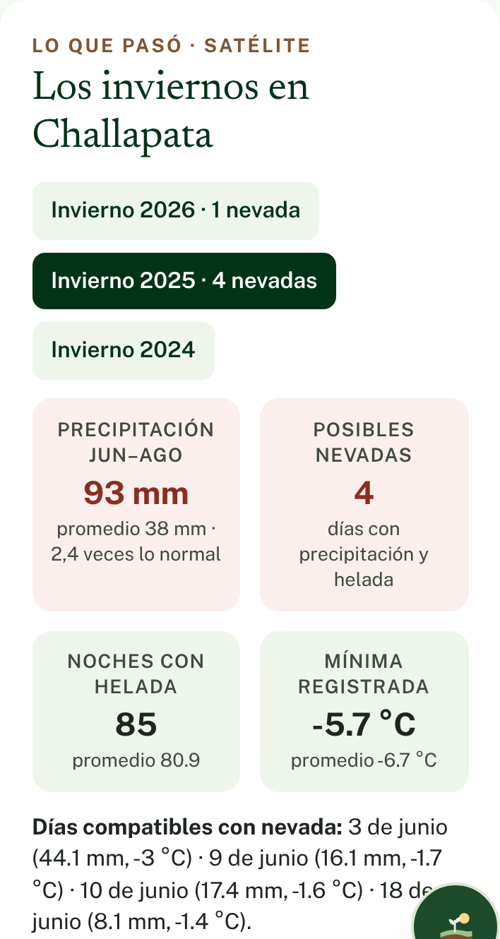
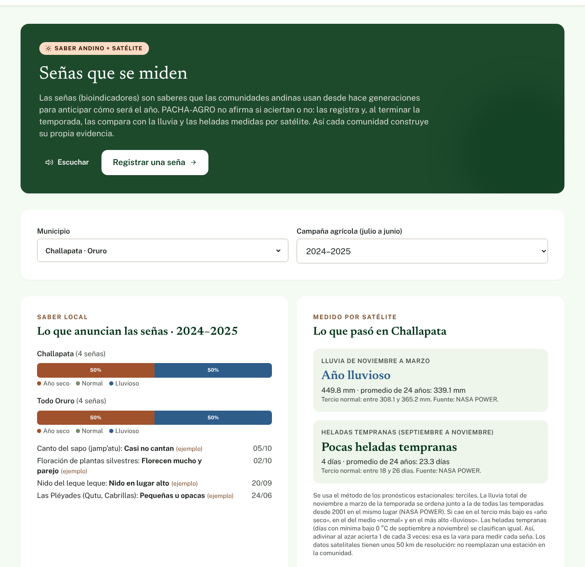

# AgroBolivia (PACHA-AGRO)

**Plataforma inteligente de asistencia agroclimática y comunicación comunitaria para agricultores de Bolivia.**

> *Tu campo, tu comunidad, mejores decisiones.*

Une el pronóstico real, los datos satelitales y el saber andino para decidir cuándo sembrar y cuándo proteger al ganado. Incluye comunicación comunitaria (comunidades, reuniones, avisos, reportes) y lecciones breves para interpretar el clima y reducir riesgos.

> **PACHA-AGRO** es el nombre de marca que aparece en la interfaz; **AgroBolivia** es el nombre técnico del prototipo.

| | |
|---|---|
| **Demo en vivo** | <https://agrobolivia.onrender.com> |
| **Backend** | FastAPI + Python 3.12 |
| **Frontend** | React 18 + TypeScript + Vite |
| **Base de datos** | SQLite en desarrollo · PostgreSQL en producción |
| **Despliegue** | Render |
| **Licencia** | MIT |

Portada en escritorio (tipografías Newsreader y Public Sans, íconos de línea propios; cada bloque muestra datos reales con su fuente):


| Inicio | Asistente de siembra | Resultado explicable | Clima |
|---|---|---|---|
|  |  |  |  |

## Un problema real: «Uywa · Ganado en riesgo»

Nace de una familia criadora de ovejas en la **comunidad Huayñacagua**: no tienen corral techado, en invierno el pasto se seca, el suelo se agrieta, las ovejas adelgazan y hay que comprar alimento; algunas crías mueren. En comunidades vecinas, las **nevadas mataron llamas**. La sección **Ganado** (`#/ganado`) muestra esas fotos (con permiso, sin datos de ubicación) y ofrece:

- **Noches peligrosas para el rebaño**: con el pronóstico real (mínima, nevada probable, viento de la noche) avisa qué noches encerrar y abrigar a las crías, con acciones de bajo costo. También responde Pacha IA («¿mis ovejas corren peligro esta noche?»).
- **Alerta temprana de año seco**: une lo que anuncian las **señas** de la zona con la lluvia de la temporada medida por satélite (terciles desde 2001) y la temporada pasada, para empezar a guardar forraje meses antes.
- **Los inviernos según el satélite**: detecta días compatibles con nevada (precipitación con helada). Con datos reales de NASA POWER, el invierno de 2025 en Challapata tuvo **93 mm de junio a agosto, 2,4 veces lo normal**, con posibles nevadas el 3, 9, 10 y 18 de junio (44 mm el 3 de junio con −3 °C).
- **Calculadora «¿hasta cuándo me alcanza el forraje?»**: ovejas, llamas, alpacas y vacas; fardos, kg o quintales; días que alcanza, lo que falta hasta que vuelva el pasto y su costo.
- **Cómo proteger al rebaño sin techo**: muros contra el viento, dormidero, cama seca, depredadores, planificación de pariciones.
- **Pérdidas de la comunidad e informe para autoridades**: cada familia registra sus pérdidas (especie, causa, comunidad); se publican solo totales. El informe imprimible junta pérdidas + datos del invierno para pedir forraje, materiales para cobertizos y asistencia técnica.
- **Negocios de la zona en los 9 departamentos**: 204 negocios de veterinaria, asistencia técnica, forraje, ganadería e insumos (La Paz, Oruro, Potosí, Cochabamba, Chuquisaca, Tarija, Santa Cruz, Beni y Pando), tomados del directorio público BoliviaHub y filtrados para quedarse con lo útil para el campo. Se muestran primero los del municipio elegido, con filtros por servicio, la fuente, la fecha y el aviso de que PACHA-AGRO no los verificó; sin NIT. Están separados de los técnicos de la Asesoría, que solo aparecen con su consentimiento.
- **Sin internet** (`#/sin-internet`): en el campo no siempre hay datos ni luz. Con señal se **guarda la semana** (pronóstico, noches peligrosas, alerta de año seco, boletín) y luego se ve sin conexión, con la fecha en que se guardó; la app se **instala** en el celular (ícono propio) y se abre sin internet; y un **boletín por SMS** sin tildes (160 caracteres por mensaje en vez de 70: cuesta menos) o para leer en la **radio comunitaria** se envía con un toque.



## Lo nuevo: «Señas que se miden»

Las comunidades andinas anticipan el año con **señas** (bioindicadores): las Pléyades (*Qutu*) en la madrugada de San Juan, el nido del *leque leque*, el aullido del zorro, la floración de la t'ola. Las apps agrícolas las ignoran y los programas tradicionales las anotan en papel. **PACHA-AGRO las registra y, al terminar cada temporada, mide si acertaron** con la lluvia y las heladas medidas por satélite en ese mismo municipio. No conocemos otra herramienta abierta y comunitaria que lo haga.

- **Dos saberes lado a lado.** Lo que anuncian las señas de la comunidad (votos por año seco, normal o lluvioso) junto a lo que realmente pasó, medido con NASA POWER.
- **Medición rigurosa.** La temporada se ubica por **terciles** frente a todas las temporadas desde 2001, el método usual de los pronósticos estacionales. Por construcción, adivinar al azar acierta 1 de cada 3 veces, y cada seña se compara contra esa vara. Con datos reales, Challapata da: 2015–16 (El Niño) **seca**, 2023–24 **normal**, 2024–25 **lluviosa** y 2025–26 **seca**.
- **Respaldo científico donde existe.** La visibilidad de las Pléyades en junio se relaciona con El Niño (Orlove, Chiang y Cane, *Nature* 403, 2000). Para las demás señas, la plataforma no opina: mide.
- **Pachagrama digital.** El calendario vivo de la campaña semana a semana: lluvia, promedio desde 2001, heladas, reportes de la comunidad y señas registradas. Está inspirado en el Pachagrama en papel de los *Yapuchiris* del Altiplano.
- **Evidencia que crece cada año.** Cada registro nuevo mejora la tabla de aciertos de su departamento. El saber local se vuelve un dato que la comunidad puede defender ante técnicos, municipios y financiadores.



## Qué funciona hoy

| Función | Estado |
|---|---|
| Página principal con navegación que se adapta a móvil, tableta y escritorio | Sí |
| Selección de departamento → municipio → cultivo (9 departamentos, 32 municipios) | Sí |
| Clima: pronóstico **Open-Meteo**, respaldo **MET Norway**, historial y climatología **NASA POWER**, riesgo de helada, tormentas | Sí: datos reales (con caché y respaldo) |
| Recomendación de siembra con factor decisivo, acción principal y fuentes | Sí: **Quinua en el Altiplano** (Oruro, Potosí, La Paz) · Papa, Maíz, Haba y Cebada con reglas preliminares (*demostración*) · si el cultivo no es de la zona, sugiere los que sí |
| Registro e inicio de sesión de agricultores (celular + clave) | Sí |
| Comunidades con aprobación del administrador; solicitudes de unión aprobadas por el representante | Sí |
| Reuniones, confirmación de asistencia, avisos, reportes de helada/granizo, historial | Sí |
| **Muro del campo**: publicaciones abiertas a todos (preguntas, clima, ganado, siembra, compra y venta), respuestas, «Me sirve», filtros por municipio o departamento y reportes que ocultan lo ofensivo | Sí |
| Panel de administración: comunidades, permisos, usuarios, reportes | Sí |
| Asistente de WhatsApp | **SIMULADOR** (no conectado). Arquitectura y webhook oficial listos para credenciales |
| Módulo educativo "Aprendamos sobre nuestro campo" (7 lecciones con preguntas y fuentes) | Sí: español · quechua/aimara pendientes de revisión lingüística |
| Avisos regionales segmentados (nacional, departamento, municipio o cultivo), publicados por administradores o editores, con vigencia y etiqueta *no oficial* | Sí |
| Cultivos de interés en el perfil (filtran los avisos que recibe cada persona) | Sí |
| Biblioteca filtrable por cultivo, tipo y departamento (8 guías con nota de fuente) | Sí |
| Cobertura nacional (mapa de municipios y qué hay en cada departamento), privacidad y términos | Sí |
| **Mi campo**: revisión por foto, calculadoras, fumigación, fichas y parcelas | Sí; ver detalle abajo |
| Bienvenida en la primera visita (cultivos, perfil y ubicación) | Sí; se puede saltar |
| **Señas que se miden** y **Pachagrama digital**: registro, comparación con satélite y tabla de aciertos por departamento | Sí, con datos reales de NASA POWER |
| **Pacha IA**: asistente flotante por voz y texto en todas las pantallas | Sí; usa Groq o el motor local |
| **Asesoría**: respuestas del campo y directorio de técnicos/agrónomos | Sí; con contactos cargados con consentimiento |
| Adaptador para fuente meteorológica oficial con contrato normalizado | Sí: listo; se activa con `OFFICIAL_WEATHER_URL` |
| Avisos oficiales SENAMHI | No: no integrados (ver [docs/FUENTES_DATOS.md](docs/FUENTES_DATOS.md)); se enlaza al sitio oficial |

Nada se presenta como algo que no es: los datos **simulados**, las **observaciones comunitarias**, los **datos ingresados por el agricultor** y los **pronósticos** llevan etiquetas distintas en la interfaz y en la API.

### Estado del prototipo

- **Con datos reales:** clima (Open-Meteo con respaldo MET Norway), historial y climatología NASA POWER, y medición de señas.
- **En modo demostración:** WhatsApp, algunas reglas de papa/maíz y los datos de ejemplo con `SEED_DEMO=true`.
- **Experimental:** umbrales y calendarios agronómicos, pendientes de validación por agrónomos.
- **No integrado:** avisos oficiales del SENAMHI; la app enlaza a su sitio.

### Mi campo

- **Revisión por foto:** posibles causas, qué verificar y primeras medidas sin químicos; la foto no se guarda y nunca se indican productos ni dosis.
- **Calculadoras:** ganancia, rendimiento requerido, precio sin pérdida, presupuesto de insumos y mezcla según la etiqueta; acepta quintales y arrobas.
- **Fumigación:** condiciones hora por hora según viento, lluvia, temperatura y humedad.
- **Fichas de cultivo** con lectura en voz alta.
- **Parcelas:** superficie medida caminando con GPS, gastos, cosecha, ventas, balance y rendimiento.

La revisión por foto usa un modelo de visión de Groq (gratuito) con `GROQ_API_KEY`. Sin clave ofrece una guía por síntomas.

### Pacha IA y Asesoría

- **Pacha IA** es el asistente flotante de toda la app: entiende voz y texto, usa el clima real del municipio y responde con Groq o con el motor local.
- **Asesoría** es el espacio para preguntas del campo y el directorio de técnicos/ingenieros agrónomos con WhatsApp, llamada o correo.
- Los contactos los elige el servidor del directorio: solo técnicos con consentimiento, cargados por el administrador. La IA nunca inventa teléfonos ni enlaces.

## Ejecutar (5 minutos)

Requisitos: **Python 3.12** (probado; 3.11 compatible), **Node.js 22** (probado; 18+ sirve para desarrollo) y npm. El Docker de Render usa Node 20 para compilar el frontend. Para la suite E2E también se instala Chromium mediante Playwright.

```bash
cd backend && python -m venv .venv && .venv/bin/pip install -r requirements-dev.txt && cp .env.example .env
```

Edite `backend/.env` (al menos `SECRET_KEY` y `ADMIN_PASSWORD`). Para generar una clave segura:

```bash
python -c "import secrets; print(secrets.token_urlsafe(48))"
```

En producción use `ENVIRONMENT=production` y una `SECRET_KEY` de 32 caracteres o más. La base de datos es SQLite por defecto en desarrollo; para PostgreSQL configure `DATABASE_URL`.

La IA es opcional. Con una clave gratuita de Groq se activan Pacha IA, la asesoría y la revisión de plantas por foto; sin `GROQ_API_KEY` la app sigue funcionando con el motor local y una guía por síntomas.

```bash
# Opcional, en backend/.env
GROQ_API_KEY=
GROQ_MODEL=openai/gpt-oss-120b
GROQ_VISION_MODEL=meta-llama/llama-4-scout-17b-16e-instruct
```

Luego compile el frontend:

```bash
cd frontend && npm install && npm run build
```

Y arranque todo en un solo proceso (la API sirve también la web compilada):

```bash
cd backend && .venv/bin/uvicorn app.main:app --port 8000
```

Abra <http://localhost:8000>. Documentación interactiva de la API: <http://localhost:8000/docs>.

Para desarrollar con recarga en caliente, deje el backend corriendo y en otra terminal:

```bash
cd frontend && npm run dev
```

(Vite en <http://localhost:5173> redirige `/api` al backend.)

### Variables de entorno principales

| Variable | Uso | Obligatoria |
|---|---|---|
| `SECRET_KEY` | Firma los tokens de sesión. Debe tener 32+ caracteres en producción | Sí en producción |
| `DATABASE_URL` | SQLite en desarrollo; PostgreSQL en producción | Recomendada |
| `ADMIN_PHONE` / `ADMIN_PASSWORD` | Cuenta administradora inicial | Sí para administrar |
| `SEED_DEMO` | Carga cuentas y datos ficticios. Use `false` en producción | No |
| `OPEN_METEO_API_KEY` | Plan pagado de Open-Meteo si se agotan las consultas gratuitas | No |
| `GROQ_API_KEY` | Pacha IA, asesoría y revisión de plantas por foto | No |
| `WHATSAPP_ENABLED` y `WHATSAPP_*` | Conectar WhatsApp Cloud API; sin ellas se usa el simulador | No |
| `OFFICIAL_WEATHER_URL` | Fuente meteorológica oficial con contrato normalizado | No |

El archivo completo está en [`backend/.env.example`](backend/.env.example).

### Estructura del repositorio

```text
backend/       API FastAPI, servicios de clima y recomendación, pruebas
frontend/      React + TypeScript + Vite
e2e/           Pruebas de navegador con Playwright
docs/          Arquitectura, algoritmo, fuentes, despliegue y límites
api/           Entrada para Vercel
Dockerfile     Imagen única para Render
render.yaml    Blueprint de Render
```

### Cuentas ficticias para pruebas locales (`SEED_DEMO=true`)

| Rol | Celular | Clave |
|---|---|---|
| Representante (Comunidad Demo Challapata) | 70000001 | demo1234 |
| Agricultora | 70000002 | demo1234 |
| Administrador | el de `ADMIN_PHONE` | el de `ADMIN_PASSWORD` |

## Desplegar

Use `SEED_DEMO=false` en producción.

- **Render (recomendado):** *New + → Blueprint* → elegir este repositorio. `render.yaml` crea el servicio (Docker) y la base PostgreSQL; solo pide `ADMIN_PHONE` y `ADMIN_PASSWORD`.
- **Vercel (alternativa):** ya configurado con `vercel.json` y `api/index.py`; requiere conectar PostgreSQL (Neon).

Guía paso a paso de ambos: [docs/DESPLIEGUE.md](docs/DESPLIEGUE.md).

## Pruebas

```bash
cd backend && .venv/bin/python -m pytest
```

```bash
cd frontend && npm test
```

```bash
# Desde la raíz del repositorio: instala Playwright (una sola vez)
npm install
npx playwright install chromium
npm run test:e2e -- http://localhost:8000
```

Resultados actuales: **173/173** backend y **18/18** unitarias frontend. La suite E2E tiene **38 casos** (38/38 aprobados en local) y se ejecuta con `npm run test:e2e`; GitHub Actions ejecuta backend, frontend y build en cada push a `main` (`.github/workflows/ci.yml`). Detalle en [docs/PRUEBAS.md](docs/PRUEBAS.md).

## Documentación

- [docs/ARQUITECTURA.md](docs/ARQUITECTURA.md) — arquitectura, justificación tecnológica, mapa de navegación, pantallas, seguridad.
- [docs/ALGORITMO.md](docs/ALGORITMO.md) — motor de recomendación, criterios, pesos y umbrales experimentales.
- [docs/FUENTES_DATOS.md](docs/FUENTES_DATOS.md) — evaluación de SENAMHI, NASA POWER, Open-Meteo y MET Norway.
- [docs/WHATSAPP.md](docs/WHATSAPP.md) — integración oficial, consentimiento, plantillas, costos y pasos para conectar.
- [docs/PRUEBAS.md](docs/PRUEBAS.md) — casos de prueba y resultados.
- [docs/DESPLIEGUE.md](docs/DESPLIEGUE.md) — despliegue en Render (recomendado) o Vercel.
- [docs/PUESTA_EN_MARCHA.md](docs/PUESTA_EN_MARCHA.md) — qué falta para usarlo con agricultores reales.
- [docs/LIMITACIONES.md](docs/LIMITACIONES.md) — lo que el prototipo **no** hace todavía.

## Uso real

Además de las funciones, AgroBolivia incluye lo necesario para operar fuera de una demo: clima con caché persistente y último dato disponible, ubicación por GPS, modo sin conexión, recuperación de clave sin SMS, eliminación de cuenta, modo producción que no arranca con configuración insegura y chequeo de salud. Lo que todavía depende del equipo (base de datos duradera, validación agronómica, WhatsApp de Meta, responsable de datos, piloto) está en **[docs/PUESTA_EN_MARCHA.md](docs/PUESTA_EN_MARCHA.md)**.

## Contribuir

1. Cree una rama desde `main`:
   ```bash
   git switch main && git pull
   git switch -c mi-cambio
   ```
2. Ejecute las pruebas que correspondan:
   ```bash
   cd backend && .venv/bin/python -m pytest
   cd ../frontend && npm test && npm run build
   ```
3. Para cambios de interfaz, ejecute también E2E:
   ```bash
   npm install && npx playwright install chromium
   npm run test:e2e -- http://localhost:8000
   ```
4. Abra un Pull Request describiendo el cambio, las pruebas ejecutadas y cualquier dato que siga pendiente de validación.

No suba `.env`, claves, bases de datos locales ni fotos de usuarios.

## Licencia

MIT © 2026 JEHOSEBA GABRIELA MUÑOZ VALDEZ. Ver [LICENSE](LICENSE).

## Aviso

Prototipo. Las orientaciones de siembra usan reglas y umbrales **experimentales, no validados agronómicamente**. No reemplazan a un técnico agrícola ni los avisos oficiales del SENAMHI. No se realizaron pruebas con usuarios reales ni existen métricas de impacto.
